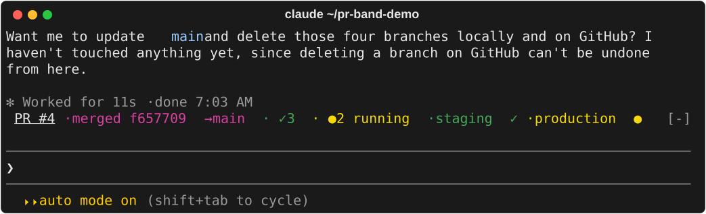
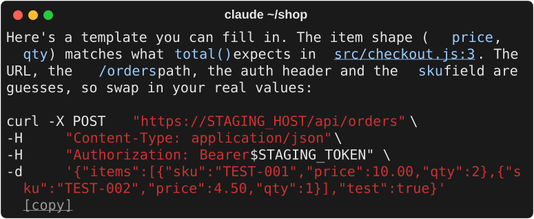

<div align="center">

# eeshan-claude-mods

Two [Claude Code mods](https://code.claude.com/docs/en/plugins/mods/overview) I use every day.

[](https://code.claude.com/docs/en/plugins/mods/overview) [](LICENSE)

[pr-band](#pr-band) · [clickable](#clickable) · [Install](#install) · [Make your own](#make-your-own)

</div>

## pr-band

Your pull request, live above the prompt.



- Checks passed, running and failed, each failure linked to its log
- Whether GitHub will merge it: `mergeable`, `conflicts with main`, `behind main`, `blocked`
- `main is red` when your base branch is failing
- After the merge, every deploy it started, then the line goes away
- A toast when checks finish, when it merges and when the deploys land

Needs the [`gh` CLI](https://cli.github.com), signed in.

## clickable

Copy any code block in one click, and open links that wrap.



- `[copy]` under every code block: Cmd-click it for the block's exact text, without the line breaks a wrapped terminal adds
- `[open]` beside a block that is only a URL or a path
- URLs and file paths become links that open whole, spaces and all

Copy links need macOS. Links work everywhere.

## Install

At the Claude Code prompt:

```
/plugin install pr-band --marketplace eeshankulk1/eeshan-claude-mods
```

```
/plugin install clickable --marketplace eeshankulk1/eeshan-claude-mods
```

Answer `y` to add the marketplace and pick a scope. The mod is on right away. From a shell, use `claude plugin install` with the same arguments.

> [!WARNING]
> Mods aren't sandboxed: they run with your permissions. Both are short, and all the code is in `mods/<name>/hooks/`. `claude plugin validate mods/<name>` lists every event a mod hooks and every call it makes.

<details>
<summary>What each mod reads and keeps</summary>

<br>

**pr-band** finds the PR from your branch, or from the URL a `gh pr create` printed in the session. It asks GitHub every 20 seconds while something runs and less often once things settle. It only draws and toasts: it never adds anything to the conversation.

**clickable** works in the classic terminal view. A click reaches the terminal, not Claude Code, and a terminal can only open a link. So on macOS the first session after install builds a small helper app (`~/Library/Application Support/clickable/Clickable Copy.app`) that opens `clickable-copy://` links and copies the saved text. Each block's text is kept in `~/.claude/clickable/copy/` for 30 days.

</details>

## Make your own

Ask Claude Code in plain words, for example "make a mod that shows my git branch above the prompt". Its built-in `plugin-authoring` skill writes the mod and reloads it as you go.

## Development

```
claude plugin test mods/pr-band && claude plugin test mods/clickable
```

Found a bug? [Open an issue](https://github.com/eeshankulk1/eeshan-claude-mods/issues).

## License

[MIT](LICENSE)
